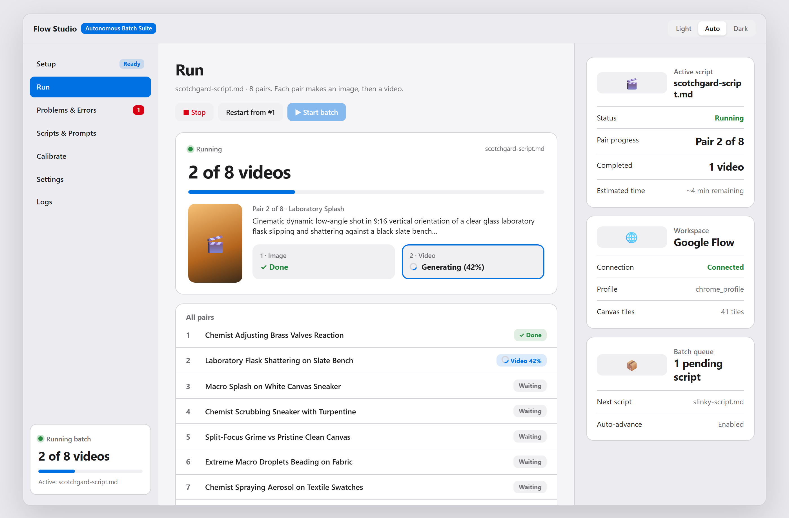
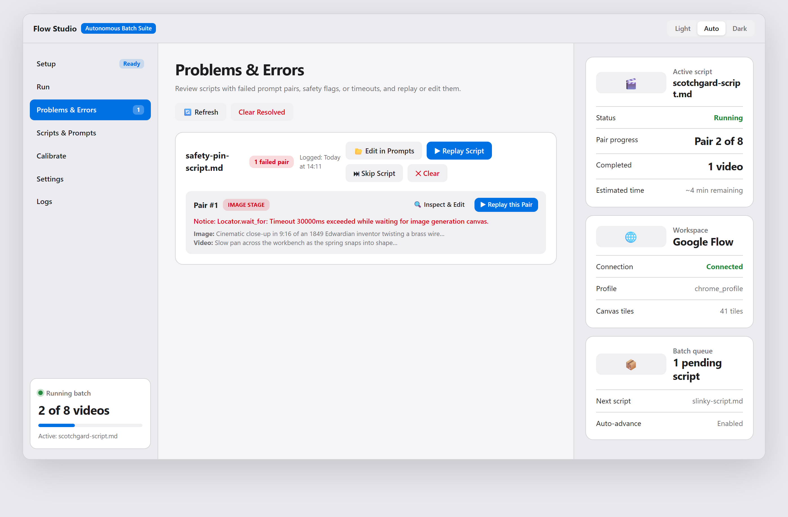
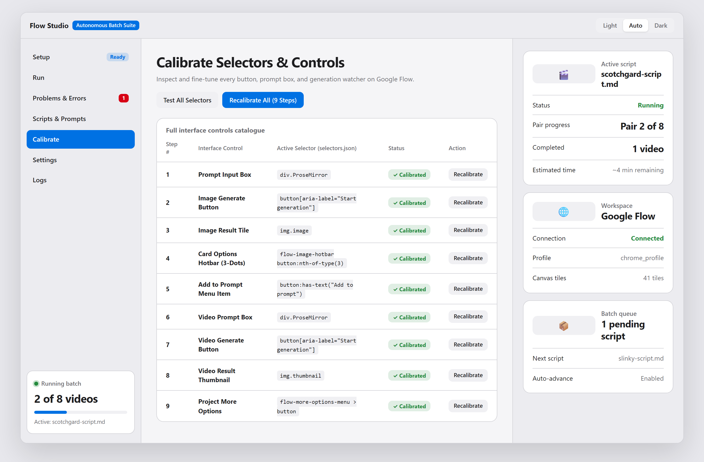
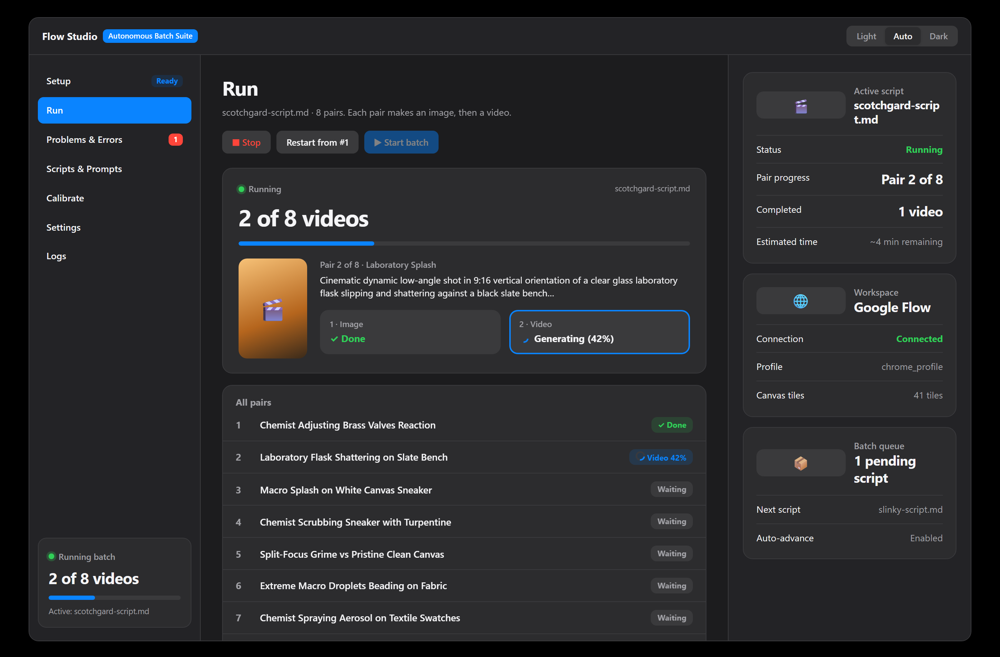

# Flow Studio — Autonomous Image-to-Video Engine

Flow Studio is a desktop automation suite designed for Google Flow (Veo 3.1 & Imagen 3/Flux). It autonomously ingests production packages, feeds prompt pairs, monitors live generation, intercepts safety policies, and downloads completed video files.

> 🎨 **Looking for the UI Review?**  
> Check out the complete [**UI Showcase & Visual Tour (UI_SHOWCASE.md)**](UI_SHOWCASE.md) containing high-resolution screenshots of every page, modal, and state.

---

## 🌟 Key Features

- **Autonomous Batch Pipeline:** Automatically loops through image and video prompt pairs, waits for completion, and downloads results to organized folders.
- **Resilient Error Triage:** Real-time policy violation banners, automatic retry limits, token preservation, and dedicated Problems & Errors triage view.
- **State Recovery & Resume:** Automatically detects previously generated pairs and skips them to protect precious credits and tokens.
- **Markdown Script Ingestion:** Ingests production packages directly (e.g. from `scripts/`), auto-extracting image and video prompts.
- **Visual Selector Calibration:** One-click visual recorder saves DOM selectors to `selectors.json`, making it resilient to Google Flow UI updates.
- **Live Diagnostics & Dark Mode:** Monospace live terminal stream, timing jitter settings, and native light/dark appearance modes.

---

## 🖼️ User Interface Preview

| View | Screenshot |
| :--- | :--- |
| **Autonomous Run Dashboard** |  |
| **Problems & Errors Review** |  |
| **Visual Calibration Hub** |  |
| **Sleek Dark Mode** |  |

👉 *See all 9 detailed views and specifications in [**UI_SHOWCASE.md**](UI_SHOWCASE.md).*

---

## 🚀 Quick Start

### 1. Installation
Clone the repository and install dependencies in Python 3.10+:

```bash
git clone https://github.com/Agent47c/Flow-Studio.git
cd Flow-Studio

# Install requirements
pip install -r requirements.txt

# Install Playwright browser engines
playwright install chromium
```

### 2. Configuration
Copy the sanitized settings template:
```bash
cp settings.example.json settings.json
```
Edit `settings.json` with your Google Flow project URL.

### 3. Launching
```bash
python app.py
```

1. **Sign-In:** Launch browser in visible mode to authenticate your Google Flow account. Your local profile is preserved securely in `chrome_profile/` (never committed to git).
2. **Calibrate:** Run the calibration wizard to record Google Flow DOM selectors to `selectors.json`.
3. **Queue & Run:** Load your scripts and press **Start**.

---

## 🔒 Security & Privacy Notice

- **Zero Credentials in Git:** User sessions, Chrome profiles (`chrome_profile/`), API keys, local outputs (`output/`), and debug logs are strictly ignored via `.gitignore`.
- **Sensible Delays:** Default random jitter delays (1–3s) emulate natural human interactions.

---

## 📄 License
MIT License. See LICENSE for details.

